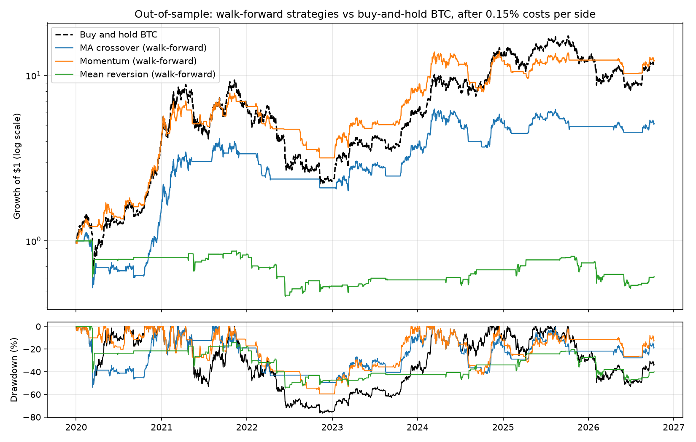

# algotrading_learner

A learning project: building Bitcoin trading strategies and backtesters from scratch in Python,
then testing them honestly — with settings chosen only on past data, after trading costs, against
simply buying and holding.

## Result

Out of sample, 1 Jan 2020 – 9 Oct 2026 (2,474 days), after 0.15% costs per trade side, long or cash only.
Each strategy re-tunes its settings every 6 months on the previous 24 months and is then traded on the
next 6 months, which it has never seen.

| Strategy | Annual return | Sharpe | Max drawdown | Days in market | Sharpe vs buy-and-hold (95% CI) |
|---|---|---|---|---|---|
| Buy and hold BTC | +43.3% | 0.59 | −76.6% | 100% | |
| Momentum (walk-forward) | +44.8% | 0.89 | −59.5% | 56% | −0.26 to +0.90 |
| Moving-average crossover (walk-forward) | +27.2% | 0.52 | −53.6% | 54% | −0.59 to +0.52 |
| Mean reversion (walk-forward) | −7.1% | −0.22 | −54.5% | 13% | −1.52 to −0.10 |



**What it shows**
- **Momentum matched Bitcoin's return with less risk:** a similar annual return while in the market
  56% of the time, with a smaller worst fall (−60% vs −77%) and a higher Sharpe (0.89 vs 0.59). But the
  confidence interval includes zero, so over this sample it **cannot be distinguished from luck**.
- **Tuning on past data mostly fitted noise.** The chosen settings averaged a Sharpe of about 1.1 in
  training but 0.3–0.6 out of sample, and a setting's training rank had almost no link to its test rank
  (rank correlation ≈ 0). The untuned 20/50 crossover (Sharpe 0.77) beat the tuned version (0.52).
- **Mean reversion lost money** and was significantly worse than holding.
- **The conclusions survive costs and a second backtester.** Sharpe ratios barely move between 0% and
  0.30% costs per side, and the event-driven simulator agrees on the ranking. The moving-average result is
  sensitive to execution timing (Sharpe 0.52 → 0.38 when trading one day later).

Full tables: [research/results/RESULTS.md](research/results/RESULTS.md). The test design was written down
and committed before the evaluation was run: [research/PLAN.md](research/PLAN.md).

## Bugs found while doing this
- **Annualising with 252 days.** That is the stock-market year; Bitcoin trades all 365 days.
- **Win rate above 100%.** Winning short days were counted, but divided by long days only.
- **Walk-forward warm-up.** Moving averages were computed on the 3-month test slice alone, so a 100-day
  average never had enough data and the strategy barely traded out of sample. Indicators now use full
  history and are then sliced.
- **No costs in the vectorised backtester.** It now charges costs on every change of position.

## Structure
```
src/fetch_binance_daily.py      download daily BTC/USDT candles (public API, no key)
src/data_loader.py              load prices and daily log returns
strategies/                     moving-average crossover, momentum, z-score mean reversion
backtesting/vectorised_backtest.py   fast whole-series backtest with costs
backtesting/event_driven.py     day-by-day account simulator (commission, slippage), grid search,
                                walk-forward, Kelly sizing
research/walk_forward_eval.py   the out-of-sample evaluation above
notes/                          beginner guides written while learning (Python, pandas, Docker, VPS, git)
scripts/                        server setup and deployment
```

## Run it
```
pip install -r requirements.txt
python src/fetch_binance_daily.py        # refresh the data (optional; a copy is committed)
python research/walk_forward_eval.py     # writes research/results/
```

## Limitations
One asset, daily bars, spot only (no shorting), a fixed cost assumption, and one market history
(2020–2026). Three strategies were tested, so some apparent edge is expected by chance.

The evaluation code in `research/` was written with AI assistance (Claude) to my specification.
